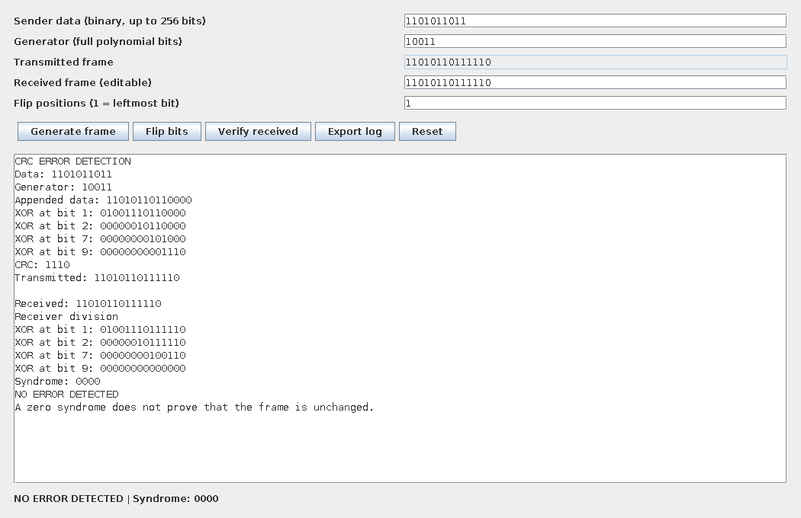
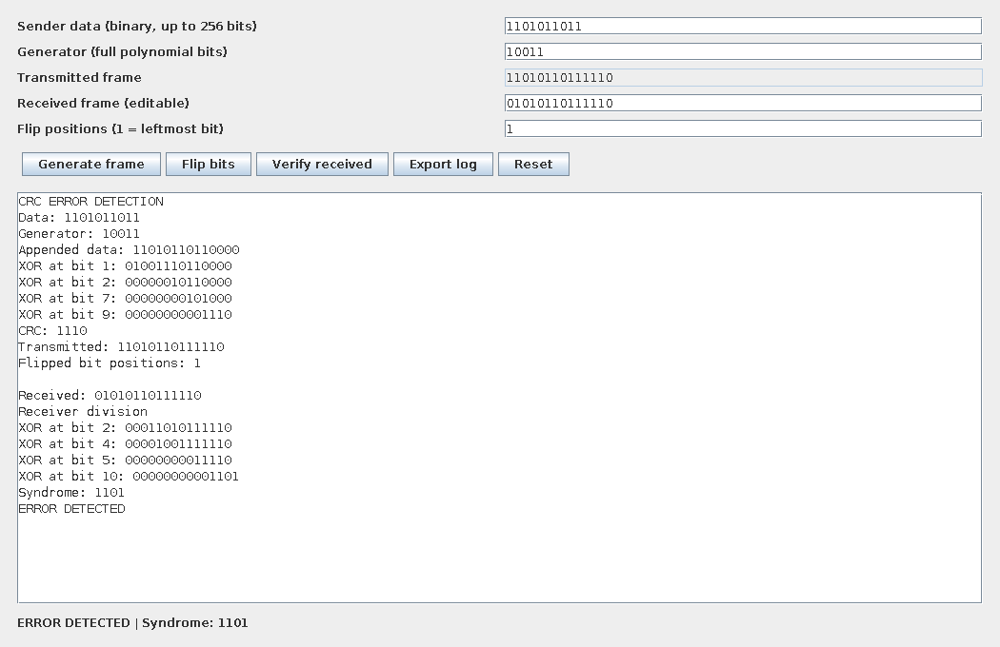
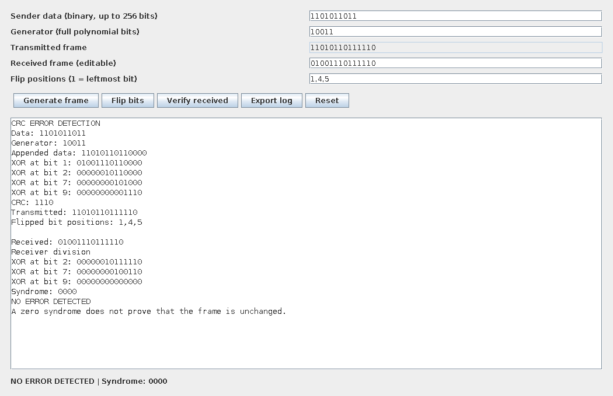

# CRC Error Detection
College Computer Networks mini project. Java 17+, Swing, no external libraries.

## Run on Windows
1. Install a full JDK 17 or newer. Check `java -version` and `javac -version`.
2. Extract the ZIP completely.
3. Double-click run.bat. A graphical desktop is required.

Manual commands from this folder:
```
javac -d build src/*.java
java -cp build CRCApp
```
On Linux/macOS run `sh run.sh` in a desktop session.

## Demonstration
- Keep Data = 1101011011 and Generator = 10011.
- Generate frame. CRC = 1110; transmitted frame = 11010110111110.
- Verify received: syndrome 0000; NO ERROR DETECTED.
- Enter flip position 1, press Flip bits, then Verify received: syndrome 1101; ERROR DETECTED.
- Generate again. Flip positions 1,4,5, then verify: syndrome 0000 although frame changed.
- Bit positions are counted from 1 at the left. Flip acts on the current received frame.
- Export log saves the XOR trace as UTF-8 text, with overwrite confirmation.
- After changing the generator, generate a new frame before verification.

## Tests and evidence
```
javac -d build src/*.java
java -cp build CRCTest
java -Djava.awt.headless=true -cp build CRCUIEvidence evidence
```
The second command runs 5128 checks. The third exercises the real Swing panel and
renders three offscreen interface captures. It does not test native window focus,
file chooser interactions or Windows installation. Test logs are in evidence/.

## Report
Editable Word and PDF reports are in docs/. Replace bracketed college, team,
register number, guide and academic year placeholders. Certificate and declaration
pages are templates; obtain genuine signatures only after review.
The report lists core CRC source; complete interface and test source is in src/.

## Scope and limitations
This is an educational binary-frame simulation with no real network connection.
Data: 1-256 bits. Generator: 2-33 bits, starting and ending in 1.
MSB-first augmented polynomial division; zero initial state; no reflection or final XOR.
It is not a drop-in CRC-16/CRC-32 implementation. Zero syndrome means no error
was detected, not proof of unchanged data. CRC detects errors, does not correct
errors, and does not provide cryptographic authentication.

## Application outputs
### Clean frame


### Detected bit error


### Undetected error example


## Project report
- [PDF report](docs/CRC_Error_Detection_Report.pdf)
- [Editable Word report](docs/CRC_Error_Detection_Report.docx)

The report includes page borders, justified paragraphs, 1.5-line body spacing,
worked examples, application outputs, test results and viva questions.
